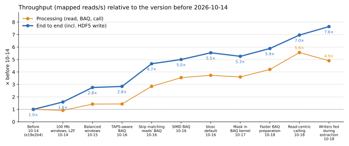
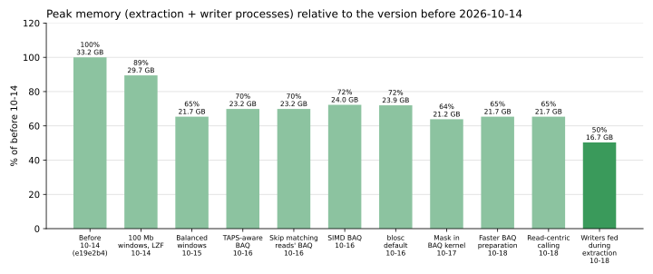

# taps-sc-extract

[](https://www.python.org/downloads/)
[](https://creativecommons.org/licenses/by-nc/4.0/)

**`taps-sc-extract`** extracts single-cell DNA methylation from coordinate-sorted alignments. It writes base-resolution calls for every cell into **Amethyst**-compatible HDF5 (`/CG/<barcode>/1`, `/CH/<barcode>/1`), as one file or as a sharded directory with a portable `master.h5`.

- **Chemistries:** TAPS (paired-end, mC read as T) and bisulfite / EM-seq (single-end BSBolt BAMs, unmethylated C read as T). The chemistry is detected from the BAM, and each has its own call rules and defaults.
- **Fast:** a Rust engine processes about 4.5M reads/s and runs end to end at 2.7M reads/s on a 16-core workstation. A Python reference engine behind the same command gives identical calls (with `--no-baq`, since it never runs BAQ).
- **Exact:** TAPS-aware BAQ runs on SIMD or GPU kernels with results identical to htslib's. Calls are checked per cell against the Python engine and against frozen references.
- **Several BAMs, one output:** pass a list or a sample sheet (TSV or Excel) with per-file cell cutoffs.
- **Built-in quality guards:**
  - M-bias measurement and automatic trimming (the bisulfite default);
  - a per-cell cap on observations per site;
  - removal of satellite pileups, when a cell list is given;
  - a blacklist BED.
- **Bounded memory and tuning:** writers run one process per shard, memory use is planned against a budget, and `--test` measures a new machine and recommends settings.

## Installation

```bash
git clone https://github.com/boconnell89/taps-sc-extract.git
cd taps-sc-extract
conda install -c conda-forge hdf5 clang libclang pkg-config   # build dependencies
./install.sh                                                  # native Rust build + pip install -e .
taps-sc-extract --help
```

- **Build:** `install.sh` builds the Rust engine for this CPU. It then checks that every BAQ kernel (and the GPU, if one is usable) gives exactly htslib's results, and stops if not.
- **Every host:** rerun it on each machine and after every `git pull`. A native build can crash with SIGILL on a different CPU; `./install.sh --portable` builds one that runs on any x86-64-v3 CPU.
- **Python engine only:** `pip install -e .`
- **Excel sample sheets:** `pip install -e .[xlsx]`

Building and upgrading: [docs/development.md](docs/development.md). GPU backends: [docs/performance.md](docs/performance.md#gpu-baq---baq-device-gpu).

## Quickstart

```bash
# Once per machine: measure it and save tuned defaults (a few minutes)
taps-sc-extract --test --save-profile

# TAPS, all cells, sharded output (workers, shards and memory mode are chosen automatically)
taps-sc-extract -b sample.bam -f ref.fa -o out/

# Bisulfite (BSBolt): detected automatically; keep cells with >= 10,000 unique reads
taps-sc-extract -b sample.bam -f ref.fa -o out/ \
    --complexity sample.complexity.txt --min-complexity 10000

# Several BAMs (a barcode in one BAM each), with a cutoff per file
taps-sc-extract -b @samples.tsv -f ref.fa -o out/

# CpG only: about 2x faster, a fraction of the output
taps-sc-extract -b sample.bam -f ref.fa -o out/ --context CG
```

`samples.tsv` is tab-separated, with a header row:

```
bam	complexity	min_complexity
lib-A.bam	lib-A.complexity.txt	10000
lib-B.bam	lib-B.complexity.txt	5000
```

**Loading into Amethyst:**

```r
library(amethyst); library(rhdf5); library(rhdf5filters)
h5 <- "out/master.h5"
ls_df <- h5ls(h5)
obj <- createObject(h5paths = data.frame(path = h5, barcode = ls_df$name[ls_df$group == "/CG"]))
obj <- indexChr(obj, "CG"); obj <- indexChr(obj, "CH")
```

More examples, covering CRAM/SAM input, the Python engine, GPU BAQ and memory and storage choices, are in [docs/modes.md](docs/modes.md).

## Performance

Reference workstation: AMD Ryzen 9 5900XT (16 cores / 32 threads), NVMe. TAPS test dataset: 53.5M mapped reads, 7,351 cells. Default settings, 2026-10-18:

| Phase | Rate |
|---|---:|
| Processing (BAM read, BAQ, calling) | 4.48M reads/s |
| HDF5 write after extraction | 6.71M reads/s |
| **End to end** | **2.69M reads/s (161M reads/min)** |
| Peak memory | 6.3 GB extraction + 10.4 GB writers |

| Faster options | End to end |
|---|---:|
| `--context CG` (CpG only) | 5.40M reads/s |
| `--no-baq` | 3.41M reads/s |
| `--context CG --no-baq` | 15.0M reads/s |

A 304-cell single-end bisulfite library (91.6M reads, no BAQ) processes at about 6M reads/s and runs end to end at 3.4M reads/s.

How speed and memory changed across releases, relative to the version before 2026-10-14:





What each option costs, and how to tune a run: [docs/performance.md](docs/performance.md).

## Documentation

| | |
|---|---|
| [Examples by use case](docs/modes.md) | TAPS, bisulfite, several BAMs, cell filters, CG-only, memory/storage, CRAM/SAM, Python engine, GPU, tuning, profiling |
| [Command-line reference](docs/usage.md) | Every option and its default |
| [What the settings do](docs/settings.md) | Filters, trims, BAQ, depth limits, per-cell caps and their effect on calls |
| [Chemistry and calling](docs/chemistry.md) | TAPS and bisulfite call rules, BAQ for TAPS |
| [Output files](docs/output.md) | HDF5 layout, metadata, reading from R and Python |
| [Performance](docs/performance.md) | Measured speed, tuning options, history |
| [Troubleshooting](docs/troubleshooting.md) | Common errors |
| [Development and testing](docs/development.md) | Building, tests, invariants |

## License

Licensed under **Creative Commons Attribution-NonCommercial 4.0 International (CC BY-NC 4.0)**; see [LICENSE](LICENSE). Free for non-commercial academic, scientific and educational research use. Commercial use requires explicit permission.
